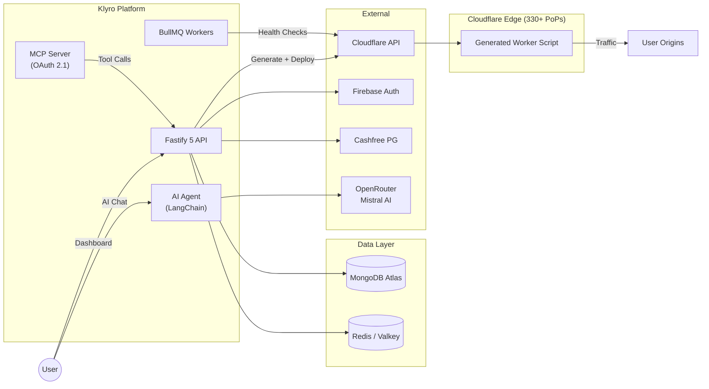
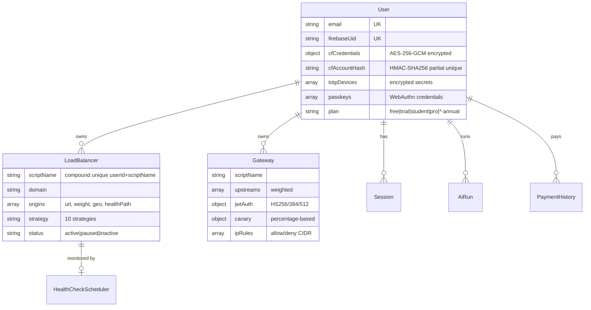

# Klyro

> Deploy production load balancers as Cloudflare Workers in ~90 seconds. Traffic flows through 330+ Cloudflare PoPs directly to user origins — never touches Klyro servers.
>
> **Stack:** TypeScript · Fastify 5 · Next.js 16 · MongoDB · Redis · BullMQ · AWS ECS Fargate

---

## Architecture



---

## Features

### Traffic Management
- **10 load balancing strategies** — round robin, weighted, IP hash, cookie sticky, weighted sticky, failover, geo-steering, API gateway, maintenance, paused
- **Path-based routing** — regex pattern matching across all strategies, route different paths to different origins
- **Geo-steering** — route by city → subdivision → country → continent with fallback chain using Cloudflare's `request.cf` geo data
- **Canary deployments** — percentage-based traffic splitting between origin groups (API Gateway mode)

### API Gateway Mode
- **JWT authentication** at the edge — HS256 / HS384 / HS512 verification inside the Worker, no round-trip to origin
- **IP access control** — allow/deny lists with CIDR notation, evaluated at the edge before the request reaches any origin
- **Response caching** — configurable cache rules per route with Cloudflare Cache API
- **Header transforms** — inject, rewrite, or strip headers on request/response
- **Mock routes** — return static JSON responses for stubbed endpoints without hitting any origin
- **3-layer rate limiting** — in-memory counter → Cloudflare Cache API → platform rate limiter binding

### Reliability
- **Health checks with auto-failover** — periodic HTTP probes (configurable 5s–3600s interval), unhealthy origins automatically excluded, Worker redeployed with updated config
- **Request cancellation** — cancel in-flight deployments from the dashboard; server detects `req.aborted` + `res.raw.close` + Redis operation store
- **Idempotent deployments** — `SHA256(userId:url:key)` deduplication with body-hash mismatch detection (409), prevents double-deploys from network retries
- **Distributed locking** — `SET NX EX` with Lua-based value release prevents concurrent deploys from claiming the same scriptName or hostname

### AI Agent
- **Natural language LB creation** — "create a failover LB for api.example.com with two origins" → fully deployed Worker
- **Multi-model fallback** — 10-model ladder across OpenRouter (free) and Mistral, fastest-first with per-model quota tracking
- **Tool-calling loop** — max 12 iterations, 6-min deadline, lazy tool discovery (saves ~1,500 tokens/iter), failure budget with automatic RCA mode
- **SSE streaming** — real-time events: `model_active`, `tool_start`, `tool_result`, `status`, `done`, `error`

### Security
- **4-layer auth** — Google OAuth (Firebase) → JWT session (httpOnly, 24h) → TOTP 2FA (multi-device) → Passkeys (WebAuthn)
- **Credentials encrypted at rest** — AES-256-GCM with 12-byte IV and separate auth tag for all Cloudflare tokens
- **Worker code obfuscation** — generated scripts obfuscated before deployment to user's Cloudflare account
- **Privilege escalation prevention** — 2FA challenge tokens carry a `stage` field; `authenticate` middleware rejects any token with `stage`
- **Sliding window rate limiting** — custom Redis Lua script with weighted two-slot window, per-route tiers (STRICT: 5/15min, MODERATE: 20/min, RELAXED: 60/min)

### Integration
- **MCP server** — full OAuth 2.1 with dynamic client registration, Streamable HTTP transport, exposes LB/Gateway/Cloudflare operations as tools
- **Cloudflare OAuth** — one-click account connection, scoped permissions (`Workers Scripts:Edit`, `Zone:Read`, `DNS:Edit`)
- **Webhook-verified payments** — Cashfree PG with HMAC-SHA256 on preserved raw body, 6 plan tiers, auto-expiry with Redis-cached plan resolution

### Edge Deployment
- **Zero-server traffic path** — deployed Workers run on Cloudflare's edge network; user traffic never routes through Klyro infrastructure
- **Under 100k req/day: \$0** — fits within Cloudflare Workers free tier
- **Per-user isolation** — each Worker lives in the user's own Cloudflare account, fully owned and deletable by the user

---

## How It Works — The Deployment Pipeline

When a user creates a load balancer, a **12-step transactional pipeline** executes with full rollback on any failure:

```
Decrypt CF credentials (AES-256-GCM)
  → Acquire distributed lock (Redis SET NX)
    → Verify name availability (DB + CF API)
      → Resolve raw IP origins → DNS hostnames
        → Generate Worker code from strategy template
          → Obfuscate (javascript-obfuscator)
            → Deploy to Cloudflare (versioned deployments API)
              → Attach custom domain (CF Workers Domains)
                → Persist to MongoDB
                  → Schedule health checks (BullMQ repeatable job)
                    → Log audit trail
                      → Release lock

Any step fails → rollback deletes Worker, DNS records, DB entries
```

---

## Technical Highlights

### Load Balancing — 10 Worker Templates

Each strategy is a self-contained Cloudflare Worker script generated server-side:

| Strategy | How It Works |
|----------|-------------|
| Round Robin | Atomic cursor, `origins[i % n]` |
| Weighted Round Robin | `Math.random() * totalWeight`, cumulative subtraction |
| IP Hash | DJB2 hash of `cf-connecting-ip` → deterministic origin |
| Cookie Sticky | `Klyro_origin` cookie (24h), random initial |
| Weighted Cookie Sticky | Sticky + weight-proportional first assignment |
| Failover | Sequential attempt, skip on status ≥ 500 |
| Geo-Steering | `request.cf` geo chain: city → subdivision → country → continent → fallback |
| API Gateway | Full gateway: weighted routing + JWT auth (HS256/384/512) + CORS + caching + canary + IP ACL + mock routes |
| Maintenance / Paused | Static 503 with custom HTML |

Every template includes: path-pattern routing, CORS injection, `X-Forwarded-*` headers, and a **3-layer rate limiter** (in-memory → CF Cache API → platform binding).

---

### AI Agent — Tool-Calling Loop with Multi-Model Fallback

```
"Create a failover LB for api.example.com with two origins"
  → Agent loop (max 12 iterations, 6-min deadline)
    → Lazy tool discovery (find_tools → schema injection, saves ~1,500 tokens/iter)
      → Model ladder: 3 free OpenRouter models → 7 Mistral models (fastest first)
        → Tool execution with failure budget (2 fails → RCA mode, 3 RCA iterations max)
          → SSE streaming: model_active | tool_start | tool_result | status | done
```

Key decisions:
- **Lazy tools**: Agent starts with only `find_tools` — discovers schemas on demand
- **409 is terminal**: Name/hostname conflicts stop the run (no silent renaming)
- **Per-model quota tracking** in Redis with provider-level cooldowns
- **Conversation persistence** with automatic context compaction

---

### Authentication — 4 Layers

```
Google OAuth (Firebase) → JWT Session (httpOnly, 24h)
                        → TOTP 2FA (multi-device, Redis single-use lock)
                        → Passkeys (WebAuthn, challenge cookies with __Host- prefix)
```

- Challenge tokens carry a `stage` field — the `authenticate` middleware **rejects** any token with `stage`, preventing 2FA challenge tokens from being used as session tokens (privilege escalation prevention)
- TOTP codes are made single-use via `SET NX` with 90s TTL (covers two 30s windows)

---

### Middleware Pipeline

```
Request → Helmet → CORS → Rate Limit (sliding window, Redis Lua) → Idempotency (SHA256 key, 24h)
  → Error Handler → Raw Body Parser (webhooks) → JWT Auth → Zod Validation → Handler
```

| Pattern | Implementation |
|---------|---------------|
| Rate Limiting | Custom Redis Lua: two time-slot sliding window, per-route tiers (STRICT: 5/15min, MODERATE: 20/min, RELAXED: 60/min) |
| Idempotency | `SHA256(userId:url:key)` → cached response in Redis (24h) + processing lock (5min), body-hash mismatch returns 409 |
| Distributed Lock | `SET NX EX` with value-based release via Lua (prevents releasing another process's lock) |
| Distributed Semaphore | Sorted set + counter with TTL cleanup |
| Request Cancellation | Monitors `req.aborted` + `res.raw.close` + Redis operation store for explicit cancel |

---

### Health Check System

```
HealthCheckScheduler (MongoDB) → BullMQ repeatable job → HTTP probe (3s timeout)
  → Reconcile: unhealthy origin excluded from Worker config → Worker redeployed automatically
  → States: healthy → unhealthy → disabled (repeated failures)
```

---

### Security

| Concern | Solution |
|---------|----------|
| Cloudflare credentials at rest | AES-256-GCM (12-byte IV, separate auth tag) |
| Account deduplication | HMAC-SHA256 of CF account ID → partial unique index |
| Token display | Masked in all API responses (`sk-...XXXX`) |
| Concurrent deployment races | Distributed lock on scriptName + hostname |
| Webhook integrity | Cashfree HMAC-SHA256 on preserved raw body |
| Worker code in user's account | Obfuscated before deployment |

---

### MCP Server

Full OAuth 2.1 implementation with Streamable HTTP transport:

```
/.well-known/oauth-protected-resource    → Resource metadata
/.well-known/oauth-authorization-server  → AS discovery
/register                                → Dynamic client registration
/authorize                               → Authorization (GET + POST)
/mcp/auth/token                          → Token exchange
/mcp                                     → MCP transport (Streamable HTTP)
```

Exposes load balancer CRUD, gateway CRUD, and Cloudflare operations as MCP tools.

---

### Data Model



---

### Infrastructure

```
Internet → Cloudflare → ALB (HTTPS, CF origin cert)
  → ECS Fargate (256 CPU / 512 MB, ap-south-2)
    → ElastiCache Valkey (Serverless, 5GB cap)
    → MongoDB Atlas

Auto-scaling: CPU target tracking (70%), min 1 → max 100 tasks
IaC: Terraform with S3 state backend
CI/CD: GitHub Actions → path-filtered tests → Docker build (GHCR) → Terraform apply → ECS force deploy
```

---

### Redis Usage — 6 Patterns

| Pattern | Key | TTL |
|---------|-----|-----|
| Sliding window rate limit | `rl:*` | Window-based |
| Idempotency cache | `idempotency:<hash>` | 24h |
| Plan tier cache | `plan:<userId>` | 2h |
| Distributed mutex | `lock:<resource>` | 180s |
| Deployment tracking | `lb:op:<operationId>` | 1h |
| AI conversation context | Conversation keys | Session-scoped |

---

### Codebase

| Metric | Count |
|--------|-------|
| Server source files | ~230 |
| Client source files | ~130 |
| MongoDB models | 7 |
| REST API endpoints | ~50 |
| Worker templates | 10 |
| AI tools | ~17 |
| Test suites | 29 (11 integration + 18 unit) |
