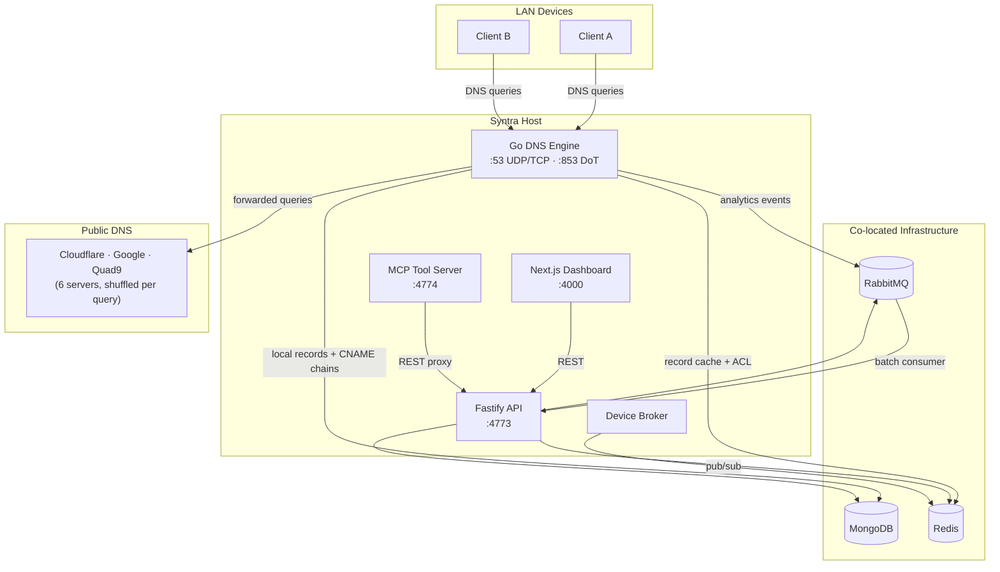
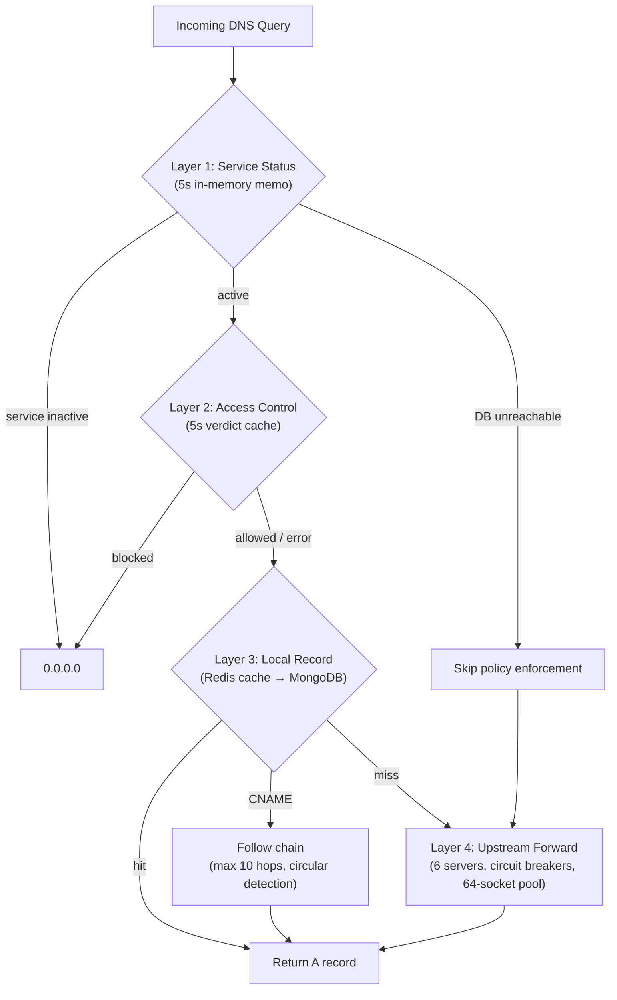

# Syntra

> Self-hosted DNS management and network surveillance system. Custom Go DNS engine handling **12,700+ QPS at 3.8ms latency** on port 53/853, backed by a TypeScript API server, Next.js dashboard, and 54-tool MCP server.
>
> **Stack:** Go · TypeScript · Fastify 5 · Next.js · MongoDB · Redis · RabbitMQ · Docker · PM2
>
> **Version:** 7.24.71-stable

---

## Architecture



---

## Features

### DNS Engine (Go)
- **4-layer query pipeline** — service status check → ACL filtering → local record lookup (Redis → MongoDB) → upstream forwarding, each layer can short-circuit
- **3 transport protocols** — UDP (multi-socket `SO_REUSEPORT`, goroutine per datagram), TCP (length-prefixed framing per RFC 1035), DoT (TLS 1.2+, auto-generated self-signed RSA-2048 cert)
- **12,746 QPS at 3.8ms** — measured with `dnsperf` on a Ryzen 5 5500U with all services co-located (floor, not ceiling)
- **Hand-rolled DNS packet codec** — byte-level parser/builder with compression pointer support (max 8 hops), explicit bounds checks, TTL rewriting across all response sections
- **CNAME chain resolution** — follows chains up to 10 hops with circular reference detection and 3s per-hop cache
- **Fail-safe design** — DB outage bypasses policy enforcement rather than returning SERVFAIL; ACL errors fail-open; DNS never stops
- **`singleflight` deduplication** — concurrent queries for the same domain collapse into one DB read
- **Auto-rebinding UDP** — polls LAN IP every 10s, rebinds sockets on address change via atomic pointer swap

### Upstream Forwarding
- **6 upstream servers** across Cloudflare, Google, Quad9 (unfiltered), shuffled per query for load distribution
- **64-socket multiplexing pool** — each socket owns the full 16-bit TXID space; generated TXIDs prevent client collisions, originals restored before reply
- **Per-server circuit breakers** — 5 failures in 30s opens the breaker, 30s cooldown, single-probe half-open state
- **2s per-server timeout** with automatic fallthrough to next server
- **Fire-and-forget analytics** — every query published to RabbitMQ, never blocks the response path

### Access Control
- **Per-IP and global blocking** — ACL policies target individual IPs, IP groups, or all users
- **Two-tier matching** — O(1) `SISMEMBER` for exact domains (fast path), small set scan for wildcards only on exact-miss
- **Boundary-aware wildcards** — `*.example.com` blocks `sub.example.com` but not `notexample.com`; `google.*` blocks `google.co.uk` but not `googlexyz.com`
- **Pre-seeded blocking groups** — Anti-Porn (92 domains), Anti-Ads (155), Anti-AI (42), all user-extensible
- **Immediate DNS effect** — every ACL mutation triggers synchronous policy reload → Redis atomic `MULTI` replace → `cache:invalidate` pub/sub → Go engine clears in-memory verdict cache

### RBAC & Auth
- **22 permissions, 5 pre-seeded roles** — Super Admin (Full Access bypass), Admin, Moderator, User, Guest
- **JWT session management** — access token (30min) + refresh token (48h), both in `httpOnly` cookies only
- **Token rotation on every refresh** — old tokens immediately invalidated, evicted from Redis
- **Single session per user** — re-login evicts previous session (Redis cache + DB)
- **Self-lockout guards** — users cannot delete/deactivate their own account or change their own role
- **Password reset kills sessions** — sets `passwordUpdatedAt: null` (triggers forced change gate), immediately evicts target user's session

### Analytics Pipeline
- **RabbitMQ batch consumer** — 1000 messages or 2s flush interval, `insertMany` to analytics collection (7-day TTL)
- **Separate channels per consumer** — deliberate fix for a bug where shared channels silently overwrote prefetch settings, causing 655k message backlog
- **Dashboard aggregation** — 24h stats via MongoDB aggregation pipeline, cached in Redis for 30min
- **Log export** — cursor-based pagination streaming to `.txt` files via background RabbitMQ consumer

### Network Discovery
- **LAN device scanning** — pings entire subnet, parses ARP table + reverse DNS, updates device list every 2 minutes
- **IP change detection** — 10s polling of `os.networkInterfaces()`, publishes change events via Redis pub/sub
- **resolv.conf management** — auto-rewrites to point at Syntra server

### MCP Tool Server
- **54 tools** — DNS CRUD, domain management, ACL policies, user admin, settings, analytics, health, all via Model Context Protocol
- **OAuth 2.1 with PKCE** — dynamic client registration, 32-byte auth codes (single-use, 60s TTL), file-persisted client registry
- **Zero business logic** — pure REST proxy to the API server over loopback, server is the sole authority
- **Credential isolation** — no login/logout tools exposed, password-like args redacted, raw tokens never returned to model
- **DNS-rebinding mitigation** — Host header validation at startup

---

## 4-Layer Query Pipeline



---

## Performance

| Load | QPS | Avg Latency | Loss |
|------|-----|-------------|------|
| 5 clients, 50 in-flight | **12,746** | 3.8ms | 0% |
| 8 threads, 2000 in-flight | 10,396 | 189ms | 0.03% |

Measured with `dnsperf`, all services co-located on a single Ryzen 5 5500U (6C/12T). This is a **floor** — dedicated hardware or separated services would improve numbers.

### Caching Layers

| Layer | Storage | TTL | Invalidation |
|-------|---------|-----|-------------|
| Service status | Go in-memory | 5s | Redis pub/sub → `ClearMemo()` |
| ACL verdicts | Go in-memory | 5s | Redis pub/sub → `ClearCaches()` |
| CNAME hops | Go `sync.RWMutex` map | 3s | Sweep at 10K entries |
| DNS records | Redis | Record TTL | Dashboard mutation → delete key |
| Sessions | Redis | 30min | Login/logout/password change |
| Dashboard stats | Redis | 30min | Cron recompute every 5min |

---

## Data Model

### MongoDB (11 Collections)

| Collection | Purpose | Key Indexes |
|------------|---------|-------------|
| `users` | Admin accounts | `username` (unique) |
| `roles` | RBAC roles | `code` (unique) |
| `permissions` | 22 permission types | `code` (unique) |
| `service` | Singleton config (status, TTL, device list) | `Service_Status` (unique) |
| `domains` | Managed domain entries | `domainStatus` |
| `dns_records` | A/AAAA/CNAME records | `domainId` |
| `analytics` | Query logs | `timestamp`, `Status`, 7-day TTL on `createdAt` |
| `access_control_policies` | ACL blocking rules | `policyName`, `isActive` |
| `domain_groups` | Named sets of domains | `name` (unique) |
| `ip_groups` | Named sets of IPs | `name` (unique) |
| `session_manage` | Active sessions | `userId` (unique), 48h TTL |

### Redis Key Scheme

| Key Pattern | Type | Purpose |
|-------------|------|---------|
| `dns-server-status` | String | Service status cache |
| `Domain_DNS_Record:<name>` | String | DNS record cache |
| `acl:ip:<ip>:exact` / `wild` | Set | Per-IP blocked domains |
| `acl:all_users:exact` / `wild` | Set | Global blocked domains |
| `session:<token>` | String | Session cache (30min) |
| `acl:reload-lock` | String | Distributed lock for ACL reload |

### RabbitMQ

| Queue | Publisher | Consumer | Pattern |
|-------|-----------|----------|---------|
| `DNS_analytics` | Go engine (fire-and-forget) | Batch cron (1000 msgs / 2s) | Analytics ingestion |
| `logs_export` | Export API endpoint | Background worker | Job queue |

---

## Dependency Wiring (Go)

Compile-time DI in `app.go` — no reflection, no string keys:

```
MongoDB (background connect) → CollectionManager
RabbitMQ (background connect) → Publisher
Redis → CacheStore + PubSub + ACLService → cache.Service
cache.Service + RabbitMQ → forwarder.Service (64-socket pool + circuit breakers)
BlockList + ServiceStatus + dbpool + cache + rabbit + forwarder → StartRules
StartRules → UDP servers (SO_REUSEPORT × 75% CPUs) + TCP server + DoT server
```

MongoDB connects in the background deliberately — the fail-safe pipeline forwards upstream while Mongo is unreachable, so DNS starts answering immediately on boot.

---

## API Server Cluster

```
Primary process:
  → Connect MongoDB, seed RBAC, generate JWT secret (wx + 0600)
  → Start 6 cron jobs
  → Fork workers (75% of CPUs, round-robin scheduling)

Workers:
  → Fastify instance each
  → Dead worker auto-restart (1s backoff)
```

### Cron Jobs

| Job | Interval | Function |
|-----|----------|----------|
| LoadPolicies | 60s | ACL policy → Redis expansion (exact/wildcard split, atomic `MULTI`, distributed lock, pub/sub invalidation) |
| BatchAnalytics | Continuous | RabbitMQ batch drain (1000/2s) → `insertMany` |
| DashboardAnalytics | 5min | MongoDB aggregation pipeline → Redis cache |
| ConnectedIPFetcher | 2min | Subnet ping + ARP + reverse DNS |
| LogsExportWorker | Continuous | Cursor-based analytics → text file export |
| CleanupExports | Periodic | Stale export file removal |

---

## Deployment

### Docker

4 containers — `docker-compose.yml`:

| Container | Image | Notes |
|-----------|-------|-------|
| `Syntra` | Custom (3-stage build) | `host` network + `privileged`, binds :53/:853/:4000/:4773/:4774 |
| `mongodb` | `mongo:7.0.43` | Pinned — 8.0+ has kernel compat issues |
| `redis` | `redis:8.10.2-alpine` | AOF + RDB, `allkeys-lru` |
| `rabbitmq` | `rabbitmq:4.3.6-management` | Management UI on :15672 |

### Dockerfile — 3-Stage Build

1. **Go builder** — `golang:1.26-alpine`, static binary (`CGO_ENABLED=0`, stripped)
2. **Node builder** — `node:24-alpine`, builds all TS/JS packages, prunes to production
3. **Runtime** — `ubuntu:24.04`, Node 24 + PM2, raises `net.core.rmem_max/wmem_max` to 4MB

### Process Supervision

PM2 manages 4 Node processes (`server`, `client`, `dhcp`, `tools`). Go DNS engine runs outside PM2 — supervised by a shell restart loop in `docker-entrypoint.sh` (needs root for port 53/853 binding).

### CI/CD — GitHub Actions

```
Push → Detect changes (paths-filter)
  → Vitest (server: 28, tools: 18, dhcp: 4 specs) + Go tests (build + vet + gofmt + test -coverprofile)
    → Docker build + push to GHCR (gated on test pass)
      → Release: .deb + .tar.gz for amd64/arm64/i386 (prunes to 2 most recent)
```

---

## Testing

4 suites, all offline (no live infrastructure):

| Suite | Specs | Coverage |
|-------|-------|----------|
| `Test/server/` | 28 Vitest | Middlewares, database, helpers, Redis, DI, logs, RabbitMQ |
| `Test/tools/` | 18 Vitest | All 10 tool groups, ApiClient, HealthMonitor, OAuth provider |
| `Test/dhcp/` | 4 Vitest | Config, IP scanning, resolv.conf management |
| `Web/**/*_test.go` | 13 files | Pipeline layers, ACL wildcards, CNAME chains (circular), forwarder + breakers, wire format |

Fakes: `fakeMongo`, `fakeRedis`, `fakeAmqp`, `fakeReply`, `fakeRequest` — same argument shapes as production.

---

## Security

| Concern | Implementation |
|---------|---------------|
| Session tokens | `httpOnly` cookies only, never in JSON responses |
| JWT secret | 256-bit random, `wx` flag + mode `0600` (race-safe across cluster workers) |
| Password storage | bcrypt hash, policy enforced on create/reset/change |
| Command injection | `execFile()` with argument arrays, never shell strings |
| MCP credentials | No login tools exposed, password args redacted, tokens never in tool results |
| TLS certificates | Atomic write (temp + fsync + rename) |
| ACL reload | Redis distributed lock (30s TTL) prevents concurrent policy expansion |
| DNS-rebinding | MCP Host header check at startup |

---

## Engineering Decisions

1. **Go for DNS, TypeScript for API** — Go handles the hot path (raw packets, goroutine per query), TypeScript handles CRUD/admin where developer velocity matters more
2. **MongoDB for DNS records** — enables dashboard, ACL system, and analytics without a separate datastore; unusual vs. zone files, but the right trade-off for a management product
3. **RabbitMQ for analytics** — fire-and-forget publishing means analytics can never block a DNS response, even if the broker is down
4. **Circuit breakers per upstream** — a dead server is skipped in microseconds, not after a 2s timeout
5. **Separate channels per consumer** — learned from a real bug where shared prefetch caused silent throughput collapse (655k message backlog)
6. **Shared npm package** — extracted after discovering `assertQueue` argument mismatches that had to be found and fixed in two copies independently
7. **PM2 for Node, shell loop for Go** — PM2 adds nothing for a compiled binary that manages its own goroutines
